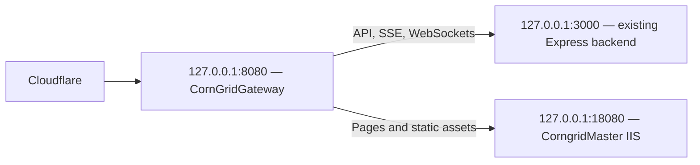

# Website and node capacity recovery

Admin capacity edits use `PATCH /api/admin/sandbox/nodes/:id/capacity` and retain the existing occupied-slot checks, PostgreSQL row lock and audit trail. They do not restart terminals or change licenses.

Admin Sandbox requests normally abort after 30 seconds. Capacity saves use a ten-second deadline and five-second read-back checks, with at most two save attempts. A network failure or retryable proxy error triggers a fresh node-list read: if the desired capacity is already saved, the dialog completes without another mutation. Otherwise it retries once. Persistent failures restore the controls, retain the input and explain that the save could not be confirmed. A completed save updates local state immediately; a slow dashboard refresh no longer keeps the form busy.

The client sends `expectedMaxInstances` captured when the dialog opens. Under the same row lock as the update, the API rejects a conflicting admin change with 409. A repeated request for the already-saved capacity succeeds without another audit entry. Older clients that omit the expectation remain supported.

PostgreSQL now uses finite defaults:

| Setting | Default |
| --- | --- |
| `PG_CONNECTION_TIMEOUT_MS` | 5000 |
| `PG_LOCK_TIMEOUT_MS` | 5000 |
| `PG_STATEMENT_TIMEOUT_MS` | 15000 |
| `PG_QUERY_TIMEOUT_MS` | 20000 |

All overrides must be positive whole milliseconds. Keep the statement timeout below the query timeout. Server-side cancellation rolls back transactional edits. Client-side query timeouts discard the pinned connection. Idle pool connection errors are handled without logging query parameters or credentials. These are [documented node-postgres connection options](https://node-postgres.com/apis/client).

The Windows website watchdog checks the origin, public domain, and Cloudflared readiness at loopback `http://127.0.0.1:20241/ready`. A public timeout plus confirmed zero tunnel connections participates in recovery. Three consecutive failures and a ten-minute cooldown remain required. A public timeout while the tunnel is healthy does not restart it. If the tunnel exposes metrics on another port, set `-TunnelReadyUrl` on the scheduled watchdog action. The probe must remain loopback.

It separately probes the optional `CornGridGateway` service at `http://127.0.0.1:8080/api/health/ready`. When the backend is healthy and the gateway is not, it recovers the gateway after three failed checks, instead of restarting Cloudflared. `-GatewayProbeUrl` can override that loopback probe for isolated testing.

## Validation

- `npm test`: isolated application, authorization, capacity, subscription, payments, agent and watchdog regression tests.
- `TEST_POSTGRES_URL=<test database URL> node --test test/postgres-availability.test.js`: creates a random schema and validates row-lock cancellation, transactional rollback, queue recovery and loss of an idle connection. Drops only that schema afterward. Use a test database with permission to create schemas and terminate its own sessions.
- `node marketing/inspect-node-capacity.cjs`: authorized read-only operational latency/node checks. The explicit `capacity` operation sets the Winslet node (ID 3) to ten slots; it is an operational action, not a test fixture.

## Windows client IIS gateway

Winslet runs Windows 10 Home. Persistent agent and administrator WebSockets consumed the low IIS request-execution quota. During reproduction, `HTTP Service Request Queues(CorngridMaster)\CurrentQueueSize` was **5**, while PostgreSQL had no blocked transaction and the direct Express endpoint remained fast. Closing the admin WebSocket drained the IIS queue to **0**; the same authenticated capacity edit then returned **200 in 56ms**. Requests had been waiting before they reached Express. An HTTP/2 tunnel alone did not solve this IIS limit.

The fixed loopback gateway keeps the existing domain and separates operational traffic from that quota:

`service/iis-gateway.js` streams requests/responses with backpressure using built-in Node HTTP/TCP modules. It never chooses an upstream from user input. Cookies, Origin, raw webhook/upload bytes and the existing backend's authentication, CSRF, licensing and rate limits remain authoritative. API connections use a separate pool; static IIS requests are limited to two concurrent upstream connections. No new inbound public ports or credentials are required.

The Windows service runs from `C:\ProgramData\CornGrid\Gateway` and binds **loopback only**. WinSW restarts it on failure and rotates its logs. Its only service dependency is TCP/IP: normal `CornGridWeb` application restarts do not require stopping the gateway. The existing IIS control site on port 80 is untouched. The Cloudflare tunnel still targets loopback port 8080.

Host-guarded installation is in `marketing/install-loopback-gateway.ps1`; it verifies the existing site/root/binding, stages the service, moves only `CorngridMaster` from `*:8080:` to `127.0.0.1:18080:`, validates readiness and checks that existing MT5 PIDs survived. It restores the binding and disables the gateway on an installation failure. This is installation on the website host, not an agent installer for customer sandbox VPS machines.

For a manual rollback, an administrator must stop and disable `CornGridGateway`, restore the saved IIS binding in `C:\ProgramData\CornGrid\Gateway\binding-before.json`, then start `CorngridMaster`. That restores the old IIS quota limitation. Do not stop the gateway while leaving IIS on port 18080 if public access must continue.

## Incident validation on 13 November 2026

- The real mobile admin page was tested through `corngrid.com` with its normal cookie/CSRF authentication and live WebSocket enabled. Saving completed and the dialog closed.
- A successful save response was deliberately discarded in the browser. Read-back confirmed the saved value, the dialog still closed, and only one mutation was sent.
- Isolated tests cover failed requests, duplicate retries without duplicate audits, conflicts between administrators, prolonged outages, authorization failures, raw webhook bytes and concurrent sockets with an API write still available.
- The page now honors `#sandbox` on load and the header Refresh action reloads sandbox data.
- All seven pre-existing MT5 processes and both running customer sandboxes survived the gateway installation. Their licenses and broker credentials were not changed.

Current configured capacities remain Winslet 10 (2 occupied) and VPS80481 2. The gateway removes the confirmed IIS bottleneck; an Internet/upstream outage can still interrupt connectivity.
